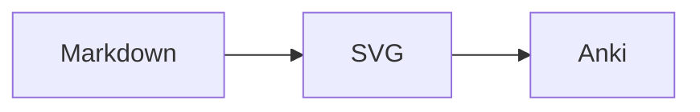

# md2anki

Turn Obsidian-style Markdown into Anki cards, without leaving your vault.

`md2anki` treats each `####` heading as a flashcard, renders the card body to HTML, uploads local images through AnkiConnect, and adds an "open in Obsidian" link back to the exact source block. Later runs only add, update, delete, or skip what changed.

## Basic and Cloze

### Basic note

<table>
<tr>
<th width="50%">Obsidian source after first sync</th>
<th width="50%">Anki HTML</th>
</tr>
<tr>
<td width="50%" valign="top">

<pre><code>---
ankideck: Engineering::Pumps
---

#### What does a pump volute do?

^anki-1783400717267

![[pump.png|900]]

---

The volute is the spiral casing
around the impeller.

It collects high-velocity flow
from the impeller and helps
convert velocity into pressure.
</code></pre>

</td>
<td width="50%" valign="top">

<div>
  <p><strong>Front</strong></p>
  <p>What does a pump volute do?</p>
  
  <hr>
  <p><strong>Back</strong></p>
  <p>The volute is the spiral casing around the impeller. It collects high-velocity flow from the impeller and helps convert velocity into pressure.</p>
  <p><a href="#">open in Obsidian</a></p>
</div>

</td>
</tr>
</table>

### Cloze note

<table>
<tr>
<th width="50%">Obsidian source after first sync</th>
<th width="50%">Anki result</th>
</tr>
<tr>
<td width="50%" valign="top">

<pre><code>---
ankideck: Programming::Python
---

#### Which runtime properties matter here?

^anki-1783400717268

Python uses {{c1::dynamic typing}}, and CPython
uses a {{c2::global interpreter lock::three-letter abbreviation}}.

---

The lock is commonly abbreviated GIL.
</code></pre>

</td>
<td width="50%" valign="top">

<div>
  <p><strong>One note creates two cards</strong></p>
  <p><strong>Card 1 question</strong></p>
  <p>Which runtime properties matter here?</p>
  <p>Python uses <strong>[...]</strong>, and CPython uses a global interpreter lock.</p>
  <hr>
  <p><strong>Card 2 question</strong></p>
  <p>Which runtime properties matter here?</p>
  <p>Python uses dynamic typing, and CPython uses a <strong>[three-letter abbreviation]</strong>.</p>
  <hr>
  <p><strong>Back Extra</strong></p>
  <p>The lock is commonly abbreviated GIL.</p>
  <p><a href="#">open in Obsidian</a></p>
</div>

</td>
</tr>
</table>

The `^anki-...` lines above are illustrative note IDs. Do not invent one for a new note: omit the line, run an apply sync, and `md2anki` will write back the ID returned by AnkiConnect. Cloze syntax is inferred per H4 block, so Basic and Cloze notes can live in the same Markdown file.

## Key Features

- **Vault-native cards:** write normal Markdown; `####` headings become Anki notes.
- **Basic and Cloze notes:** ordinary blocks become Basic notes, while `{{cN::...}}` in the prompt automatically selects Anki's built-in Cloze type.
- **Stable anchors:** new cards get `^anki-<id>` written back to Markdown, so future syncs and source links stay attached to the right card.
- **Incremental sync:** repeat runs skip unchanged cards and update only the notes that changed.
- **Strict model contracts:** apply mode verifies the exact Basic/Cloze field names through a read-only AnkiConnect query before making any writes.
- **Deck hierarchy:** `ankideck` and the nearest parent heading map directly to nested Anki decks.
- **One-click source return:** every Anki card includes an `open in Obsidian` footer that jumps back to the exact Markdown block.
- **Rich rendering:** supports Markdown, tables, code blocks, math, Mermaid diagrams, wiki links, and `![[image.png|width]]` embeds.

## Install

Requirements:

- Python `>=3.10`
- Node.js and the Mermaid CLI available as `mmdc`
- Anki desktop
- AnkiConnect add-on installed and available at `http://127.0.0.1:8765`
- Anki's built-in `Basic` note type with `Front` and `Back` fields
- Anki's built-in `Cloze` note type with `Text` and `Back Extra` fields

Install the Mermaid CLI globally, then confirm that `mmdc` is on `PATH`:

```bash
npm install -g @mermaid-js/mermaid-cli
mmdc --version
```

If npm reports that Puppeteer's install script was blocked, allow it explicitly:

```bash
npm install -g --allow-scripts=puppeteer @mermaid-js/mermaid-cli
```

`md2anki` uses an installed Chrome, Edge, or Chromium when available and otherwise lets Mermaid CLI use its bundled browser.

Clone or download this repository, then install it from the repository directory:

```bash
python -m pip install .
```

For development, use an editable install with the test dependencies:

```bash
python -m pip install -e ".[test]"
```

The `md2anki` command can then be run from any directory.

## Quick Start

1. Start Anki and make sure AnkiConnect is enabled.
2. Add `ankideck` frontmatter to a Markdown file in your Obsidian vault.
3. Write each card under a `####` heading. Leave out `^anki-*` for a new card.
4. Run apply mode to create the Anki notes and write their IDs back to Markdown.

Run the synchronization:

```bash
md2anki --vault-root D:/Notes/MyVault --apply-anki-changes
```

Interactive terminals show one compact progress bar followed by the final CRUD summary. Add `--verbose` to replace the bar with per-file and per-note progress details.

To preview the planned add, update, and delete operations without writing anything, omit `--apply-anki-changes`:

```bash
md2anki --vault-root D:/Notes/MyVault
```

Process only one file, relative to the vault root:

```bash
md2anki --vault-root D:/Notes/MyVault --file "Biology/cells.md" --apply-anki-changes
```

Synchronization state is stored in `<vault-root>/.md2anki-cache/sync_state.json`, and images are resolved under `<vault-root>/assets`. Override the image location with `--asset-root` when needed.

Before apply mode creates decks, uploads media, or changes notes, it calls the read-only AnkiConnect `modelFieldNames` action for every note type used in the run. A missing, renamed, reordered, or additional field aborts the run instead of allowing AnkiConnect to silently ignore an invalid payload.

## Card Format

- A file must have frontmatter `ankideck`.
- Each `####` heading starts one Anki note. A file may contain multiple notes.
- The H4 heading is always included in the question text.
- A block is inferred as Cloze when its H4 heading or content before the first `---` contains `{{cN::...}}`, including the optional `{{cN::text::hint}}` form. Otherwise it is Basic.
- Basic with `---`: the H4 and content above the separator become `Front`; content below it becomes `Back`.
- Basic without `---`: the H4 becomes `Front`; the entire body becomes `Back`.
- Cloze with `---`: the H4 and content above the separator become `Text`; content below it becomes `Back Extra`.
- Cloze without `---`: the H4 and entire body become `Text`; authored `Back Extra` is empty. The generated source footer is still added to `Back Extra`.
- Cloze syntax below `---` does not affect inference because that content belongs to `Back Extra`.
- Basic and Cloze blocks may be mixed in the same Markdown file.
- The nearest preceding H3, H2, or H1 heading is appended to `ankideck` as a child deck.
- `^anki-<id>` is standalone metadata immediately below the H4 heading; blank lines around it are allowed.
- `^noanki` in the same metadata position skips the H4 block completely.
- `![[image.png]]` and `![[image.png|900]]` load images from the configured asset root and upload them to Anki media.
- A fenced `mermaid` block is rendered locally to SVG and uploaded as Anki media instead of being shown as source code.

For example, an `ankideck` of `Engineering` under `### Pumps` syncs into `Engineering::Pumps`. If no H1/H2/H3 parent exists, the note stays directly in the frontmatter deck.

Only `^anki-*` and `^noanki` are recognized as synchronization metadata.

For example, this block creates one Cloze note and two cards, one for each cloze number:

```markdown
#### Which runtime properties matter here?

Python uses {{c1::dynamic typing}}, and its standard implementation uses a
{{c2::global interpreter lock::three-letter abbreviation}}.
---
The H4 remains visible as a concise reminder, while this section becomes Back Extra.
```

Keep an existing note's inferred type stable. Before apply mode writes anything, `md2anki` checks the actual Anki type of existing notes whose Markdown content changed and aborts if Basic was changed to Cloze or vice versa. Anki cannot update one note type with the other type's fields. Create a new Markdown block instead when a type change is intentional. Dry-run does not query Anki, so this check runs only in apply mode.

## Sync Lifecycle

| Markdown state | Apply result |
| --- | --- |
| H4 without metadata | Adds an inferred `Basic` or `Cloze` note and writes `^anki-<id>` below the H4 |
| H4 with `^anki-<id>` and changed content | Updates the existing Anki note |
| H4 with `^anki-<id>` and unchanged content | Skips the note |
| H4 with `^anki-<id> DEL` or `^anki-<id> DELETE` | Deletes the Anki note and replaces the ID metadata with `^noanki` |
| H4 with `^noanki` | Skips the block without adding, updating, or deleting anything |

The generated answer-side field (`Back` or `Back Extra`) includes an `open in Obsidian` link targeting the Markdown file and its `^anki-<id>` block anchor. Renaming a note heading does not break its synchronization identity.

## Rendering

`md2anki` renders standard Markdown, tables, fenced code blocks, inline and display math, Mermaid diagrams, Obsidian wiki links, and wiki images. Math delimiters are normalized for Anki's built-in MathJax support, and media files are uploaded through AnkiConnect.

After uploading media, `md2anki` checks the returned filename against Anki's actual directory entries using `getMediaFilesNames`. HTML image references use the directory entry's exact case, including when an Anki/AnkiConnect version returns the requested uppercase spelling for an existing lowercase file. Existing uppercase media names remain uppercase. Resolved names are reused only within the current run; the Markdown content hash and persistent sync-state format are unchanged.

To repair existing cards with incorrect image filename case, close any running md2anki process, delete only `<vault>/.md2anki-cache/sync_state.json`, and run synchronization again with Anki open. Keep the Markdown `^anki-<id>` metadata: those IDs cause existing notes to be updated in place, preserving their cards and review history. This rebuilds the cache and updates all included notes once. Then sync Anki and its media to your other devices. Ordinary unchanged notes remain skipped on subsequent runs.

Mermaid blocks use the normal Obsidian syntax:

````markdown

````

The Mermaid source is rendered by the local `mmdc` prerequisite into a neutral-theme SVG with a white background. Generated filenames are derived from the Mermaid source, so identical diagrams reuse the same Anki media file. Rendered SVGs are cached directly in `<vault>/.md2anki-cache/mermaid/`; unchanged diagrams do not start `mmdc` again on later runs, and deleting only that `mermaid` directory forces regeneration. A missing CLI, invalid diagram, timeout, or empty output fails rendering before any Anki write instead of silently syncing Mermaid source code.

For the matching light/dark card presentation, copy [anki-card-style.css](anki-card-style.css) into the Styling section of both the Anki `Basic` and `Cloze` note types used by these cards. The stylesheet includes theme-aware `.cloze` colors.

Complete Basic and Cloze front and back templates, including local highlight.js code highlighting, are available in [anki-card-templates.md](anki-card-templates.md).

To distinguish the Markdown H4 title from front-side context, wrap the front field in a dedicated container in the Anki card template. The stylesheet makes its first paragraph larger and bold, with extra space below it. Scoping this rule to the front container prevents answer paragraphs from receiving title styling. Existing notes pick up the template and styling changes without resynchronization.

```html
<!-- Basic: wrap the existing Front field replacement. -->
<div class="md2anki-front">{{Front}}</div>

<!-- Cloze: wrap Text on both the front and back templates. -->
<div class="md2anki-front">{{cloze:Text}}</div>
```

Keep the rest of your templates, including any syntax-highlighting scripts. Basic back templates using `{{FrontSide}}` inherit the front container automatically. If the Basic back template repeats `{{Front}}` directly, wrap that replacement too. Do not wrap `{{Back}}` or `{{Back Extra}}` in this container.

## Windows Launcher

After installing the package, copy `md2anki.cmd` into the root of an Obsidian vault and double-click it. The launcher uses its own directory as `--vault-root`, runs in apply mode, and shows a compact progress bar followed by the final CRUD summary.

It invokes the installed package as `python -m md2anki`. To use a specific virtual environment or a Python path containing spaces, set `MD2ANKI_PYTHON` before launching:

```bat
set "MD2ANKI_PYTHON=C:\path\to\.venv\Scripts\python.exe"
md2anki.cmd
```

## Safety

Dry-run is the default command-line behavior. Only `--apply-anki-changes` writes to Anki, `.md2anki-cache/sync_state.json`, or Markdown. Apply mode may insert `^anki-<id>` or replace deleted-note metadata with `^noanki`.

Use only IDs written back by `md2anki`; a hand-written `^anki-<id>` is interpreted as an existing Anki note. Markdown and its `^anki-<id>` metadata remain the source of truth. Deleting `.md2anki-cache` does not delete Anki notes, but the next apply performs an expensive full synchronization and regenerates Mermaid SVGs.

## Development

```bash
pytest -q
pytest tests/e2e/test_mock_ankiconnect_flow.py -q
```

E2E tests use a local mock AnkiConnect server and do not touch a real Anki database.

## References

- Design notes: [doc/design.md](doc/design.md)
- Release checklist: [doc/release_checklist.md](doc/release_checklist.md)
